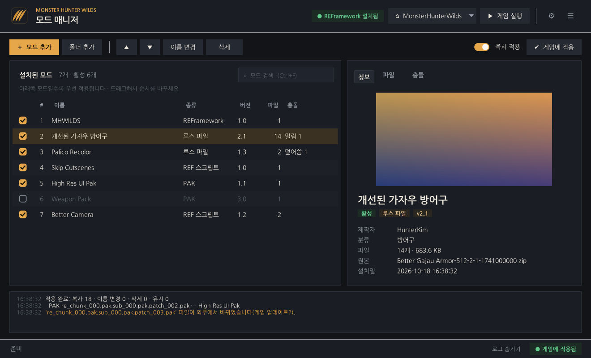
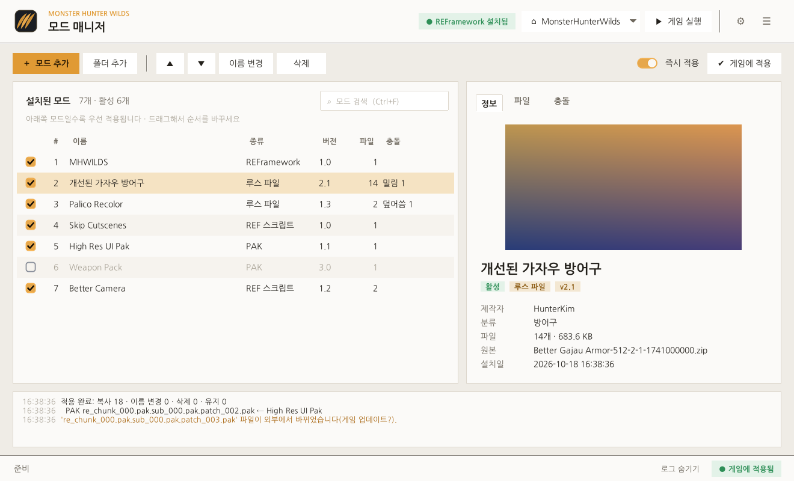

# 몬스터 헌터 와일즈 모드 매니저

Monster Hunter Wilds(몬스터 헌터 와일즈) PC판용 모드 관리 프로그램입니다.
Nexus Mods 등에서 받은 모드 압축 파일을 끌어 놓기만 하면 설치되고, 체크박스로 켜고 끌 수 있으며,
게임 폴더에 넣은 파일을 모두 기록해 두었다가 깨끗하게 되돌립니다.



## 주요 기능

- **압축 파일 그대로 설치**: zip / 7z / rar / 폴더 / 단일 `.pak`·`.lua`·`.dll` 파일
  - 압축 안의 폴더 구조를 분석해서 게임 폴더 기준 위치를 자동으로 찾습니다.
  - Fluffy Mod Manager 형식(`modinfo.ini`)의 이름·제작자·버전·설명·미리보기 이미지를 읽습니다.
  - 옵션이 여러 개 들어 있는 압축 파일은 **모드 하나로 설치**되고, 옵션은 설치한 뒤 언제든 **옵션** 탭에서
    켜고 끌 수 있습니다. 처음에는 모든 옵션이 꺼져 있으니 사용할 옵션을 골라 주세요(여러 개 함께 켤 수 있음).
  - Nexus 파일 이름(`이름-123-1-2-1740000000.zip`)에서 모드 이름과 버전을 뽑아냅니다.
  - 한글 파일 이름이 들어 있는 zip(cp949)도 깨지지 않습니다.
- **모든 모드 형식 지원**
  - 루스 파일 모드 (`natives/STM/...`)
  - PAK 모드 — 게임 폴더의 `pak_mods` 폴더에 로드 순서대로 넣어 REFramework가 불러오게 합니다
  - REFramework 스크립트/플러그인 (`reframework/autorun/*.lua`, `reframework/plugins/*.dll`,
    `reframework/` 폴더 없이 `autorun/`만 들어 있는 경우 포함)
  - REFramework 자체(`dinput8.dll`)와 기타 DLL 모드
- **켜기/끄기와 로드 순서**: 체크박스로 켜고 끄며, 드래그 또는 ▲▼ 버튼으로 순서를 바꿉니다.
  목록 아래쪽 모드일수록 우선 적용됩니다.
- **충돌 한눈에 보기**: 같은 파일을 바꾸는 모드끼리 몇 개의 파일이 겹치고 어느 모드가 이기는지, 아무것도 적용되지 않는 모드가
  있는지 한 창에서 보여 줍니다. 모드를 고르면 그 모드를 덮어쓰는 모드(빨강)와 그 모드에 밀리는 모드(청록)가 목록에 표시됩니다.
- **필요한 모드 알림**: 설치한 모드에 필요한 다른 모드(Nexus 모드 페이지의 Requirements, 스크립트가 불러오는 Lua 라이브러리)가
  없거나 꺼져 있으면 알려 줍니다.
- **안전한 적용/해제**
  - 게임 폴더에 넣은 파일을 모두 기록하고, 바뀐 부분만 복사·삭제·이름 변경합니다.
  - 모드가 원래 게임 파일을 덮어쓰면 백업해 두었다가 모드를 끌 때 복원합니다.
  - 모드를 끄면 비게 된 폴더까지 정리합니다. 직접 넣은 다른 파일은 건드리지 않습니다.
- **게임 폴더 점검**: 적용한 파일이 바뀌거나 없어지면 프로그램을 켤 때 알려 주고, 다시 적용하면 원래대로 돌려 놓습니다.
- **프로필**: 켜 둔 모드, 옵션, 로드 순서를 프로필별로 저장하고 한 번에 바꿉니다 (예: "기본", "사진 촬영용", "바닐라").
- **모드 업데이트 확인 (Nexus Mods)**: 내 Nexus API 키로 설치한 모드에 새 파일이 올라왔는지 확인하고,
  버전 칸에 `1.0 → 1.2`처럼 보여 줍니다.
- **검색과 필터**: 모드 이름 검색(Ctrl+F)과 활성 / 비활성 / 옵션 선택 필요 / 충돌 있음 / 업데이트 있음 필터.
- **다크 / 라이트 테마**와 여러 설정: 창 크기·위치 기억, 게임 실행 전 자동 적용, 실행 후 창 최소화, 삭제 확인 등 (설정 ⚙).
- **기타**: Steam 라이브러리에서 게임 폴더 자동 감지, REFramework 설치 여부 표시, 게임 실행 버튼,
  모드 교체 설치(같은 이름이나 같은 Nexus 모드를 교체할 때 순서·활성 상태 유지), 명령줄(CLI) 지원

## 설치 및 실행

### 방법 1: 실행 파일(.exe)

저장소의 [**Releases**](https://github.com/skagks/asdijofosjifjsioiofasojif/releases/latest) 페이지에서 `MHWildsModManager.exe`를 받아 실행합니다.
설치는 필요 없습니다. 처음 실행할 때 Windows SmartScreen 경고가 뜨면 **추가 정보 → 실행**을 누르세요
(서명되지 않은 실행 파일이라 나오는 경고입니다).

직접 만들려면 Python을 설치한 뒤 `build_exe.bat`를 실행하면 `dist\MHWildsModManager.exe`가 만들어집니다.

### 업데이트

v1.2.0부터는 프로그램이 켜질 때 새 버전을 확인합니다. 새 버전이 있으면 오른쪽 위에 **⬆ 업데이트** 버튼이 생기고,
누르면 변경 내역을 보고 바로 업데이트할 수 있습니다 (내려받은 파일은 SHA-256으로 확인한 뒤 프로그램을 다시 시작하며
교체합니다). ☰ 메뉴 → **업데이트 확인**으로 직접 확인할 수도 있습니다. 그 전 버전을 쓰고 있다면 한 번만 Releases에서
직접 받아 주세요.

> 실행 파일이 `C:\Program Files`처럼 쓰기 권한이 없는 폴더에 있으면 자동 업데이트를 할 수 없습니다.
> 바탕 화면이나 문서 폴더 같은 곳에 두고 쓰세요.

### 방법 2: Python으로 실행

1. [Python 3.10 이상](https://www.python.org/downloads/)을 설치합니다 (설치할 때 *tcl/tk* 포함, 기본값).
2. (선택) 추가 기능 설치: `pip install -r requirements.txt`
   - `tkinterdnd2`: 탐색기에서 파일을 끌어 놓아 설치
   - `Pillow`: JPG 미리보기 이미지 표시
   - `py7zr`: 다른 압축 프로그램 없이 `.7z` 압축 풀기
3. `MHWildsModManager.pyw`를 더블클릭하거나 `python -m mhwmm`을 실행합니다.

> `.rar` · `.7z` 파일은 PC에 설치된 **반디집** 또는 **7-Zip**으로 풀어서 설치합니다. 둘 다 없으면 Windows 11에
> 들어 있는 기본 압축 풀기(tar)를 시도합니다. zip 파일은 아무것도 없어도 됩니다.

## 사용법

1. 처음 실행하면 Steam 라이브러리에서 게임 폴더를 찾습니다. 못 찾으면 오른쪽 위 **⌂ 게임 폴더** 버튼 → **다른 폴더 선택...**으로
   `MonsterHunterWilds.exe`가 있는 폴더를 지정하세요.
2. **＋ 모드 추가**를 누르거나 모드 압축 파일을 창에 끌어 놓습니다.
3. 체크박스(또는 더블클릭, 스페이스바)로 켜고 끕니다. **즉시 적용**이 켜져 있으면 바로 게임 폴더에 반영되고,
   꺼져 있으면 **게임에 적용**(Ctrl+S)을 눌러야 반영됩니다.
4. 같은 파일을 바꾸는 모드끼리는 아래쪽 모드가 이깁니다. 오른쪽 **충돌** 탭에서 확인할 수 있습니다.
5. 상황마다 다른 모드 조합을 쓰고 싶으면 툴바의 **프로필** 버튼에서 새 프로필을 만들어 두고 골라 쓰세요.
   새로 설치한 모드는 다른 프로필에서는 꺼진 상태로 들어갑니다.

프로그램 안에서 **F1**(또는 **☰ → 사용법**)을 누르면 주제별로 정리된 사용법과 단축키를 볼 수 있습니다.

### REFramework

루스 파일(`natives`) 모드와 Lua 스크립트는 [REFramework](https://github.com/praydog/REFramework-nightly/releases)가
필요합니다. **이 프로그램에서 바로 설치·업데이트할 수 있습니다.**

- 오른쪽 위 **REFramework 배지**를 누르면 설치된 빌드와 최신 nightly 빌드를 비교해 보여 주고, **설치/업데이트**를 누르면
  `REFramework.zip`을 내려받아(GitHub가 제공하는 SHA-256으로 확인) 게임 폴더에 바로 적용합니다.
- 프로그램을 켤 때 새 빌드가 있는지 확인하고, 있으면 배지가 **REFramework 업데이트**로 바뀝니다 (설정에서 끌 수 있음).
- 직접 넣어 둔 `dinput8.dll`도 몇 번째 빌드인지 알아냅니다. 이 프로그램으로 설치하면 기존 파일은 백업했다가
  REFramework 모드를 끄거나 지우면 되돌립니다.
- REFramework 안내에 따라(VR을 쓰지 않는 경우) `dinput8.dll`만 설치합니다.

루스 파일 모드는 게임 안 REFramework 메뉴의 **LooseFileLoader → Enable Loose File Loader**가 켜져 있어야 합니다.

### 필요한 모드 확인

모드를 설치하면 그 모드가 필요로 하는 다른 모드가 있는지 확인해서, 없거나 꺼져 있으면 바로 알려 줍니다.

- **Nexus 필요 모드**: Nexus에서 받은 파일(또는 Nexus 링크를 설정한 모드)은 모드 페이지의 Requirements 목록을 읽어 옵니다
  (API 키 없이도 됩니다). 설치된 모드와 Nexus 번호나 이름으로 맞춰 보고, REFramework는 설치 여부로 확인합니다.
- **Lua 라이브러리**: REFramework 스크립트가 `require("…")`로 불러오는 파일을 다른 모드나 게임 폴더가 갖고 있는지 확인합니다.
- 결과는 정보 탭의 **필요한 모드**(✓ 있음 · ✕ 없음 · ! 꺼져 있음)에 나오고, 이름을 누르면 Nexus 페이지가 열립니다.
  목록에서는 주황색으로 표시되고 필터 **필요한 모드 없음**으로 모아 볼 수 있습니다.
- 다른 사이트에 있는 필요 모드는 설치 여부를 알 수 없어 "직접 확인"으로 표시합니다.

### 모드 업데이트 확인 (Nexus Mods)

설치한 모드에 새 버전이 나왔는지 [Nexus Mods](https://www.nexusmods.com/monsterhunterwilds)에서 확인합니다.

1. Nexus에 로그인한 뒤 [API 키 화면](https://next.nexusmods.com/settings/api-keys) 맨 아래의 **Personal API Key**를 복사합니다.
2. 모드 매니저의 **설정 ⚙ → Nexus Mods**에 키를 붙여 넣고 **확인**을 눌러 계정 이름이 나오는지 본 뒤 저장합니다.
3. 프로그램을 켤 때마다 자동으로 확인하고, 결과를 오른쪽 위 **모드 업데이트** 배지에 보여 줍니다 (설정에서 끌 수 있음).
   바로 확인하려면 **☰ 메뉴 → 모드 업데이트 확인 (Nexus)**를 누르세요. 배지를 누르면 업데이트가 있는 모드만 보입니다.

- Nexus에서 받은 파일을 **이름 그대로** 설치하면(`이름-1234-1-0-1740000000.zip`) 어느 모드의 어느 파일인지 알아서 연결합니다.
  이미 설치해 둔 모드도 원본 파일 이름으로 연결됩니다.
- 파일 이름을 바꿨거나 다른 곳에서 받은 모드는 목록에서 **오른쪽 클릭 → Nexus 링크 설정**에 모드 페이지 주소를 넣으세요.
  이 경우에는 모드에 적힌 버전과 Nexus의 최신 메인 파일 버전을 비교합니다.
- 새 버전이 있으면 버전 칸에 `1.0 → 1.2`가 표시되고, 정보 탭의 **Nexus 파일 페이지 열기**(또는 오른쪽 클릭 → 새 버전 받기)로
  파일 페이지를 엽니다. 받은 파일을 창에 끌어 놓고 **기존 모드를 새 파일로 교체**를 고르면 순서와 활성 상태가 유지됩니다.
  모드 이름을 바꿔 두었어도 같은 Nexus 모드면 교체할지 묻습니다.
- 다운로드 자체는 Nexus 정책상(프리미엄 회원이 아니면 API로 직접 받을 수 없음) 브라우저에서 합니다.
- API 키는 데이터 폴더의 `state.json`에만 저장되며 Nexus 외에는 보내지 않습니다. 확인할 때 최근 한 달 사이 새 파일이 없는
  모드는 건너뛰어서 Nexus 요청 한도를 거의 쓰지 않습니다.

### PAK 모드는 어디에 들어가나요?

지금의 몬스터 헌터 와일즈는 게임 폴더의 `re_chunk_000.pak.sub_000.pak.patch_NNN.pak` 중 **정품 패치 번호까지만** 읽습니다.
그래서 모드 PAK을 그 뒤 번호로 이름만 바꿔 넣으면 게임이 읽지 않습니다 (텍스처 PAK이면 REFramework가 `[Missing file] ….tex`를 띄움).

이 프로그램은 PAK 모드를 게임 폴더의 **`pak_mods` 폴더**에 넣습니다. REFramework는 이 폴더의 `.pak` 파일을 비어 있는 패치
자리에 차례로 끼워 넣어 불러옵니다.

- 파일 이름은 `001_모드이름.pak`, `002_…`처럼 로드 순서대로 번호를 붙입니다. 번호가 클수록(목록 아래쪽일수록) 우선합니다.
- 순서를 바꾸거나 모드를 끄면 파일을 다시 복사하지 않고 이름만 바꿉니다.
- `pak_mods`에 직접 넣어 둔 다른 파일은 건드리지 않습니다.
- REFramework가 필요하고, REFramework 메뉴의 pak_mods 불러오기(LoadPakDirectory)가 켜져 있어야 합니다 (기본값은 켜짐).
- v1.6.x 이하에서 패치 번호 방식으로 넣은 PAK은 프로그램을 켤 때 찾아서 `pak_mods`로 옮깁니다 (즉시 적용이 꺼져 있으면 묻습니다).

### 게임 업데이트 후

프로그램을 켤 때 적용한 파일이 바뀌거나 없어졌는지 확인해서 알려 줍니다(또는 오른쪽 위 **☰ 메뉴 → 적용 상태 점검**).
다시 적용하면 원래대로 돌려 놓습니다. 예전 방식으로 넣은 PAK 자리에 게임 업데이트가 공식 패치를 받아 놓았다면, 그 파일은 게임
파일로 두고 지우지 않습니다.

### 모드를 전부 빼고 싶을 때

**☰ 메뉴 → 게임 폴더에서 모든 모드 파일 제거**를 누르면 이 프로그램이 넣은 파일을 모두 지우고 백업해 둔 원본을
복원합니다. 설치된 모드 목록은 그대로 남아서 나중에 **게임에 적용**으로 다시 넣을 수 있습니다.

## 데이터 저장 위치

| 항목 | 위치 |
| --- | --- |
| 기본 (exe) | 실행 파일과 같은 폴더의 `MHWildsModManager_data` (없으면 자동으로 만듦) |
| exe 폴더에 쓸 수 없을 때 | `%LOCALAPPDATA%\MHWildsModManager` (예: `C:\Program Files`에 둔 경우) |
| Python으로 실행 | `%LOCALAPPDATA%\MHWildsModManager` |
| 직접 지정 | `--data-dir <폴더>` 옵션 또는 `MHWMM_DATA_DIR` 환경 변수 |

v1.2.1 이하에서 `%LOCALAPPDATA%\MHWildsModManager`에 쌓인 데이터는 v1.3.0 이상을 처음 실행할 때 exe 옆으로 자동으로
옮겨집니다. 모드 파일이 데이터 폴더에 저장되므로, 용량이 넉넉한 드라이브에 exe를 두면 됩니다.

- `mods\<id>\files\` : 설치된 모드 파일 (게임 폴더 기준 구조)
- `state.json` : 모드 목록, 순서, 활성 상태, 설정
- `deployment.json` : 게임 폴더에 넣은 파일 기록
- `backups\` : 모드가 덮어쓴 원본 게임 파일
- `manager.log` : 로그

## 명령줄(CLI)

```
python -m mhwmm list                         # 모드 목록
python -m mhwmm game [경로]                  # 게임 폴더 설정 (생략 시 자동 감지)
python -m mhwmm install 모드.zip [--option 2 | --all] [--replace] [--disabled]
python -m mhwmm options "모드 이름"             # 옵션 목록 보기
python -m mhwmm options "모드 이름" --set 1 3   # 1번, 3번 옵션만 켜기
python -m mhwmm enable 1 "모드 이름"          # 번호, 이름, id로 지정
python -m mhwmm disable 3
python -m mhwmm move "모드 이름" 5            # 로드 순서 변경 (아래일수록 우선)
python -m mhwmm remove 2
python -m mhwmm refw [--install]             # REFramework 버전 확인 / 설치·업데이트
python -m mhwmm nexus key <API 키>           # Nexus API 키 확인 후 저장
python -m mhwmm nexus check                  # 설치한 모드의 새 버전 확인
python -m mhwmm nexus link "모드 이름" https://www.nexusmods.com/monsterhunterwilds/mods/1234
python -m mhwmm nexus unlink "모드 이름"
python -m mhwmm profile                      # 프로필 목록
python -m mhwmm profile "사진 촬영용" --create [--empty]   # 새 프로필 (--empty: 모두 꺼진 상태)
python -m mhwmm profile "기본"                # 프로필 전환
python -m mhwmm conflicts [--files]           # 같은 파일을 바꾸는 모드들
python -m mhwmm deploy | purge | verify
```

`enable`/`disable`/`install` 등은 바로 게임 폴더에 적용합니다 (`--no-deploy`로 끌 수 있음).

## 주의 사항

- 같은 게임 폴더에 Fluffy Mod Manager 등 다른 모드 관리자를 같이 쓰면 서로의 파일을 알 수 없습니다.
  이 프로그램은 다른 프로그램이 넣은 파일을 건드리지 않지만, 한 가지 관리자만 쓰는 것을 권장합니다.
- 게임이 실행 중일 때는 PAK 파일이 잠겨 있어 적용할 수 없습니다. 게임을 끈 뒤 적용하세요.
- PAK 모드끼리 같은 대상을 바꾸는지는 PAK 내용을 열어 보지 않으므로 충돌 표시에 나오지 않습니다.

## 개발

릴리즈는 자동입니다. `mhwmm/__init__.py`의 `__version__`(과 `pyproject.toml`의 `version`)을 올리고
`CHANGELOG.md` 맨 위에 그 버전의 변경 내역을 적어 기본 브랜치에 푸시하면, GitHub Actions가 테스트 → exe 빌드 →
릴리즈 생성(`v` + 버전 태그, 릴리즈 노트는 CHANGELOG에서)까지 진행합니다. 버전이 그대로면 릴리즈를 건너뜁니다.

```
pip install pytest
python -m pytest
```

- `mhwmm/analyzer.py` : 압축 내용 구조 분석
- `mhwmm/deploy.py` : 게임 폴더 적용/해제, pak_mods 배치, 백업
- `mhwmm/manager.py` : 모드 목록·설정·설치
- `mhwmm/gui.py` : tkinter GUI, `mhwmm/theme.py` : 색상·글꼴·스타일, `mhwmm/cli.py` : 명령줄
- `tools/make_assets.py` : 체크박스·스위치·아이콘 이미지 다시 만들기 (Pillow 필요)

<details><summary>라이트 테마</summary>



</details>
